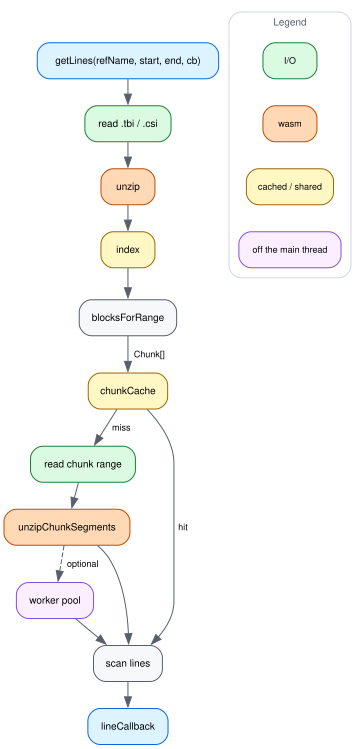

# How a query flows

`getLines` turns a region into a list of BGZF chunks through the index, reads
each chunk through `chunkCache`, and scans the decompressed bytes for lines,
handing the ones that overlap the region to your callback. The header path is
separate — `getLines` never reads it. ([dataflow.dot](img/dataflow.dot) is the
source; see [CONTRIBUTING.md](../CONTRIBUTING.md) for how to re-render it.)

The orange nodes are wasm code from
[`@gmod/bgzf-filehandle`](https://github.com/GMOD/bgzf-filehandle), and every
one of them decompresses BGZF blocks. Index parsing and the line scan run in JS.
`.tbi` and `.csi` are both bgzip-compressed, so every index read here also goes
through the wasm decompressor, unlike in `@gmod/bam`, where a `.bai` is raw
bytes.

The purple node is opt-in. With a `bgzfWorkerPool`, chunk decompression runs off
the main thread, and without one the same code runs in-process. The pool takes
over only the decompression, not the line scan, so the diagram draws the pool as
one node on a dashed edge.
[bam-js](https://github.com/GMOD/bam-js/blob/main/docs/dataflow.md) takes the
same pool from the same `@gmod/bgzf-filehandle`.

The diagram shows only the main path. It leaves out the header reads, the
read-ahead window that sets how far ahead of the scan to fetch, and the
plain-gzip fallback `unzip` takes for non-BGZF input. The first two are in
[optimizations.md](optimizations.md), which explains why each step of this path
looks the way it does.
